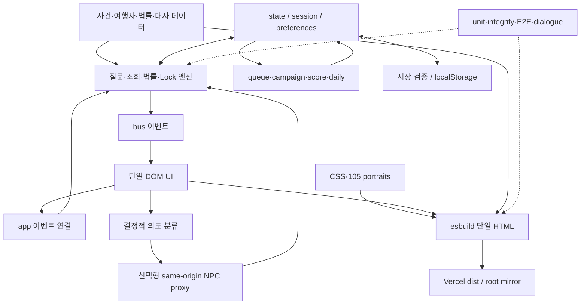

# 01 — Repository forensic audit

모든 경로/심벌은 기준 SHA `2bbdb4d8c5936640b8790e430aaa21b360b7d901` 기준이다. 이 감사 문서의 커밋이 기준 제품 SHA를 바꾸지 않는다. **VERIFIED**와 **INFERRED**를 구분하며 로그는 [evidence](evidence/README.md)에 보관한다.

## 기준선과 고고학

| 항목 | 직접 확인한 결과 |
|---|---|
| 저장소/default | `club-paradiso/inad`, `main` |
| 최신 기준 | 2026-10-03 PR18 merge, SHA 위와 같음 |
| 버전 | package10.0.0, v10.0.0 tag, UI v10.0; GitHub Release 객체 없음 |
| PR/issue | 조회 당시 PR2–18 merged, 열린 PR 없음. non-PR issue1 closed |
| branch | 원격8개 확인. 과거 Claude 작업 branch는 최신 배포의 권위가 아님 |
| PR 흐름 | 15 personas →16 v11 제목의 확장→17 Lock 확장→18 v10 release alignment. 제목의 v11을 출시 버전으로 읽으면 오판 |
| 생산 산출물 | `src/`→`dist/index.html` + root mirror. 운영 HTML과 fresh build 동일 hash |
| 서버 | `vercel.json`: framework null, npm ci/build, output dist. same-origin API 두 경로 예외 |
| 법률 baseline | metadata2026-09-07, data v6.1. 현재 한국 법률 전부를 이번에 재검증한 뜻 아님 |
| 저장 | 기존 meta/progress/campaign 버전 키와 bundle schema1 유지. 분석용 키 등 별도 존재 |
| 동결 | legacy v6.1 bytes1,514,881 및 hash 일치 |

읽은 문서: README, AGENTS/CLAUDE(동일 확인), progress, RELEASE_NOTES_v10.0, architecture, next-product-audit, v10-product-vision, v10-ai-architecture, v10-live-interview-spec, v10-privacy, v11-playtest-guide, SOURCE_PROVENANCE, legal-review, design-workflow/figma-workspace-spec. Figma 원격 metadata와 desktop 구조 와이어프레임 screenshot도 확인했다. 접근된 file snapshot은 page `2:2`의 `01 — Current Product Audit` 한 페이지이며 section `37:2`가 `[Implemented] ... v7.2 (main 845d74c ...)`로 표시된다. desktop frame `37:4`와 mobile frame `37:54`는 과거 구조 와이어프레임이다. 따라서 이 snapshot을 v10 운영 화면의 현행 승인 근거로 삼을 수 없다. v10 관련 모든 디자인이 다른 위치에도 없다는 증명은 아니다. [metadata 원문](evidence/figma-audit-metadata.xml).

과거 문서는 설계 의도를 보여주지만 제품의 현재 증거가 아니다. `progress.md`는 Oct2의 여러 테스트 횟수·미완료 provider 평가를 혼합하고, release note는 Lock을 signature mechanic으로 부른다. 아래 소스와 실행 결과를 우선한다.

## 실제 구조

화살표는 주요 호출/데이터 관계이며 완전한 import graph는 아니다. DOM-free라는 주석은 곧 순수함수를 뜻하지 않는다. 여러 엔진이 전역 state를 직접 바꾸고 bus를 발행한다. 특히 Lock은 평가와 적용을 한 호출에 묶는다.

## 하위 시스템별 책임·결합·재사용

`src/js/engines/`를 E, `src/js/services/`를 S, `src/js/ui/`를 U로 줄여 표기한다. 위험은 수정 시 회귀 위험이다. 테스트 열은 관련 검사 존재를 의미하며 충분성을 보증하지 않는다.

| 시스템 / 인터페이스 | 실제 책임·의존성·데이터 소유 | 숨은 결합·부채 / 위험 | 테스트와 플레이 영향 / 재사용 |
|---|---|---|---|
| `src/data/cases.js`, travelers/personas |12핵심 사건 정답/필수행동/문서/질문/조회,105초상 자산; author가 정사 소유 | `resolution`, clue key, questionId가 여러 엔진을 가로지름 / 높음 | case·legal·dialogue unit. 빠른 작성 가능하나 캐릭터 수≠사건 깊이. 형식 원칙만 재사용 |
| E/case-engine, current case actions | 질문·조회·처분·완료, queue/state/score/log 의존 | 수행 토큰과 사실 획득과 진행이 섞임 / 높음 | primary/special E2E와 unit. 새 사건 완료 전이는 교체 |
| E/legal-engine `validateClear/Refusal/Referral` | 작성된 정답/요구 행동·사유 확인 | 범용 법률추론 아님; referral는 fixture에 고정 / 매우 높음 | 법률 불변성 test. 소스 레지스트리 보존, 새 게임 판정기로 재사용 금지 |
| E/decision-model + data decision-rules/legal-sources | 판단 근거 설명/출처 | 설명 UI와 강제 검증의 범위가 같지 않음 / 높음 | 결정 근거/법률 unit. 설명 구조를 한정 재사용 |
| E/clue-engine `questionUnlocked` | requires 토큰과 clue triggers | ‘물었다’가 ‘안다’를 대리 / 중간 | 조건 unit. 획득 상태의 명시 모델로 재설계 |
| E/statement-lock-engine `evaluateStatementLock` | ID쌍→규칙 match→clue/log/behavior 적용 | 평가가 전역 변경, provenance 없음, F1–F4 / 높음 | Lock unit가 happy path 위주. 현재 구현 교체, 선택 UI 아이디어만 회수 |
| E/interview-engine | 의도→허용된 질문/메타/문서→작성형 응답 | unlocked/performed, language/persona/behavior 연결 / 중간 | interview unit·live E2E. 목록형 fallback과 대사 원칙 유지 |
| E/intent-engine `resolveUtterance` | 개념/문자 bigram/token으로 question/ambiguous/unknown | case text와 PERSONAS 영어 gloss에 의존, cache/lexicon 튜닝 / 중간 | 이번 고정 fixture297/297. 자연어 일반화는 미검증. 보류 가능 |
| E/suggestion-engine `suggestQuestions` | 열린 미질문과 최근 열린 follow-up 우선 | requires의 순서가 추천으로 노출 / 중간 | 순서 테스트. 새 퍼즐의 정답 힌트가 될 수 있어 재검토 |
| E/dialogue-guard + S/npc-client + api/npc | 선택형 서버 분류, allowlist, fallback | 어휘 guard는 의미 논리의 증명이 아님 / 높음 | guard/route unit, provider 실측 없음. 판정 외부위임 금지 경계 유지 |
| E/behavior-engine | 긴장/rapport, 응답 표현과 소요시간 | special에 따른 프로필, contradiction에 따른 stress / 중간 | verdict 불변성만으로 인상 편향 제거 못함. 새 슬라이스 수치 제거 |
| E/score-engine + debrief | 처리 결과/시간/절차 및 설명 | 정답/효율에 연결 / 높음 | scoring unit·debrief E2E. debrief 패턴 유지, 수치 채점 교체 |
| E/queue-engine + rng | 24생성 normal+12core, quick6, seed | RNG 소비 순서와 fixture 선택 연결 / 높음 | deterministic queue unit. rng 유지, queue 모드 보류 |
| E/campaign-engine | 다음 단계·저장·연결 단서 진행 | 행동3개 충족 상태를 관계망 추론으로 오인 가능 / 중간 | campaign unit. 새 게임에는 defer |
| E/daily-engine + achievement/companion | 날짜 seed, 일별 기록/업적/안내 |12개 순환은 새 사건 생성 아님 / 중간 | 관련 unit. 신작 핵심에 불필요 |
| E/operation-engine | 공항·부하·피로·이벤트·휴식 | state, behavior, queue, optional live snapshot 연쇄 / 높음 | 부하 상한·판정불변 unit. 운영을 핵심으로 선택한 C 외에는 보류 |
| `state.js` + S/bus | 공유 session/state, UI 이벤트 | 수평 엔진 간 mutable state; payload 비정형 / 높음 | integration이 실제 결합의 최종 방어. 새 slice reducer 격리 |
| E/save-engine + S/storage | 버전 검증, import/export, migration | 여러 저장 키와 보고서, 별도 analytics 키 / 높음 | 손상/미래버전/복원 tests. 검증 경험 재사용, 새 namespace |
| S/analytics | 허용 event를 localStorage 집계 | 이름/필드 불일치, 시도 분모 누락 / 중간 | aggregate tests≠실제 emitter 연결 확인. 새 schema/계측 필요 |
| U/* + app | singleDOM adaptive, modal, input, i18n, ARIA |91boot ID 계약, UI→engine의 많은 직접 연결 / 높음 | a11y/adaptive E2E 존재, 이번 모바일 미실행. 토큰/상호작용 원칙 보존 |
| build/assets/deploy | JS/CSS/WebP inline, source/dist/legacy targets | 단일 파일 크기와 mirror 동기화 / 중간 |10 integrity,7marker,hash. 현 슬라이스에 framework 불필요 |

## 핵심 발견

### F1 — 획득하지 않은 정보 공개 (높음, VERIFIED)

`statement-lock-engine.js`: `CASE_CONTRADICTIONS['ICN-S2-005']`의 `S2_005_CONTACT_BROKER`가 contact lookup뿐 아니라 `E-ARRIVAL`의 연락처 필드도 match target으로 허용한다. `evaluateStatementLock`는 질문ID와 target shape를 확인하고 `applySuccessfulLock`를 즉시 실행한다. 번호를 봤다는 사실이 ‘그 번호의 전산 조회 결과를 획득했다’는 사실을 대체한다.

운영 UI와 Node에서 **조회0인데 tm4 공개**. 개발자가 알고 있는 정사가 플레이어가 아는 사실에 새어 들어온다. 이는 모델 hallucination이 아니라 결정적 코드의 epistemic boundary 오류다. 새 게임은 규칙 수를 늘리기 전 acquired/observed/source lineage를 구분해야 한다.

### F2 — Lock→긴장도 NaN (높음, VERIFIED)

`applySuccessfulLock`가 `behaviorAdjust({ stress, rapport })`를 호출한다. 실제 signature는 `behaviorAdjust(stressDelta=0, rapportDelta=0,event='')`. 객체와 숫자 합이 clamp/round를 통과하며 NaN이 된다. UI ‘긴장도 NaN’을 직접 관찰했다. 이는 source typing/계약 검사의 구멍이다. 이번에는 수정하지 않았다.

### F3 — 기능 설명과 진행 규칙 불일치 (중간, VERIFIED)

`unlockQuestions`는 선언되어 있으나 소비되지 않는다. `clue-engine.js/questionUnlocked`는 `q.requires`와 `performed`만 본다. `jobOffer`에는 `QUESTION_occupation`, `LOOKUP_contact`가 필요해 Lock 성공만으로 열리지 않는다. 12core의 resolution required에 `LOCK_` 0개. Lock 없는 완료 경로가 설계상 남는다. 새 signature mechanic의 필수성을 주장할 근거가 약하다.

### F4 — 모르는 관계를 ‘모순 없음’으로 설명 (중간, VERIFIED/INFERRED)

규칙 불일치 시 `CONSISTENT`, ‘법적으로 유의미한 모순이나 불일치가 확인되지 않았습니다’ 문구. generic hotel/return lexical 비교도 출처와 시점 논증이 아니다. 규칙에 없음을 진술의 양립성으로 오해할 UX 위험이 있다. `UNKNOWN`/`UNSUPPORTED`가 별개 상태여야 한다.

### F5 — 법률 엔진 이름의 권위가 실제 범위를 초과 (높음, VERIFIED)

`validateClear` 등은 fixture의 resolution과 행동 coverage를 검사한다. 현재 refugee fixture의 `validateReferral`는 항상 false, arrest는 체크 수에 의존하는 부분이 있다. 이를 한국 법률의 보편 명제로 일반화하지 않는다. `docs/legal-review.md`도 박해 사유 인터뷰 전 불회부 순서의 미반영을 적고 있다. 강제 guard와 설명 모델을 분리하여 감사할 필요가 있다. 이번에 실제 법률 위법 판정이나 조문 변경은 하지 않는다.

### F6 — 개인정보 설명·제품 계측의 불일치 (중간, VERIFIED)

`docs/v10-privacy.md`/AI architecture의 memory-only 설명과 달리 `S/analytics.js`는 `inad-analytics-v11`에 firstSessionTime/lastUpdated 및 집계를 localStorage 저장한다. 이 집계에서 raw input 저장은 관찰하지 않았다. 따라서 ‘채팅 원문을 서버에 전송한다’고 확대 해석하면 안 된다.

app은 `live_start/quick_start/daily_start`를 내보내는데 allowlist는 `session_start`를 기대한다. case_complete/interview_turn의 caseId도 일부 발행 경로에서 빠진다. Lock은 새 성공에서만 `statement_lock_success`를 발행하고 attempt/unmatched emitter가 없다. success 처리기가 attempt와 success를 함께 더하므로 실패 분모가 사라진다. 테스트용 성공1건에서100%는 제품 성공률의 증거가 아니다. 현 계측으로 신규 유저 전환/Lock 실패율을 추정하지 않는다.

### F7 — 자연어 자유도와 영어 완성도 (중간, VERIFIED)

`resolveUtterance`는 자유 질의를 열린 세계의 사실 응답으로 바꾸지 않는다. 지정 질문/메타/문서 요청으로 분류한다. 결정적 fallback은 유용하나 새 정보 생성은 아니다. provider 테스트는 이번 미실행. English UI로 전환해도 실제 질문·대사·문서 값과 추가 coach/lock 조작 일부가 한국어다. UI 언어와 면담 언어 분리는 의도일 수 있지만 완전한 영어 플레이 지원을 확인한 것으로 표현할 수 없다.

### F8 — 행동 수치의 인식 편향 (중간, VERIFIED→INFERRED)

`makeBehavior`는 forgery를 guarded, refugee를 anxious로 설정하고 `behaviorSensitivity`는 contradiction 질문에 가산한다. 판정 결과가 국적/외모에 불변이라는 test와, 플레이어가 ‘긴장=거짓’을 학습하지 않는다는 주장은 다르다. 새 slice는 수치와 판정 연계를 없애고 표정/감정은 서사 표현으로만 둔다. 현재 국적별 위험 규칙을 발견했다고 주장하지 않는다.

### F9 — CI red의 실제 원인 (중간, VERIFIED)

과거 main CI에서 dist108은 통과했다. legacy에서 새 liveStartBtn을 찾는 cohort3개가 실패해 전체 verify가 실패했고 src parity는 실행되지 않았다. 이는 legacy target applicability 문제로 보인다. production 코드 전반이 실패했다거나 CI가 녹색이라고 둘 다 오판하면 안 된다. docs-only PR에서도 기존 실패가 재현될 수 있다. CI 수정은 별도 범위다.

## 플레이 흐름 감사

상호작용 수는 실제 계측이 없는 곳에 평균을 발명하지 않았다. ‘선택’은 게임 정보/위험을 바꾸는 결정, ‘조작’은 열기·탭·스크롤 등이다. 이하 비수동 경로는 소스/기존 test trace 기반 INFERRED UX 평가다.

| 흐름 / 증거 | 상호작용과 인지 부담 | 의미·마찰·피드백·반복 가치 |
|---|---|---|
| 초기 실행 / 수동 | hero1회로 시작; 상세 옵션은 펼침 | 접근 경로 단축은 실제 가치. 시작 선택 자체는 추론 아님 |
| onboarding / 소스+수동 일부 | coach/제안 읽기, interpreter 선택 | 다음 버튼은 알려주나 증거와 정답의 차이 설명 부족 가능 |
| 첫 live 승객 / 수동 | ICN-S2-005 고정, 통역·질문·문서 | 곧바로 갈등; 언어 장벽 조작을 추론 실력으로 혼동할 위험 |
| 질문 / 수동+소스 | 제안은1선택; 자유입력은 작성+해석/확인 | 같은 authored question으로 수렴. 자연어 표현은 선택폭과 다름 |
| 문서 / 수동 | 문서 선택→필드 선택, 비교는 추가 dialog | 발견을 위해 읽는 것은 gameplay; 탭 전환은 비용. 메모리 비교 부담 |
| 불일치 / 수동 | 진술 선택→target 선택→결과 | F1로 조사 생략 가능. 순간 보상은 있지만 논증이 없음 |
| Lock / 수동 | 질문 이후 대조3선택(열기/문서/필드) | 빠른 피드백이 잘못된 사실 확신과 NaN을 동반 |
| 처분 / 소스+과거 E2E | 사유·절차 선택 후 확정, touch2탭 보호 | 필수행동 checklist와 정답 일치가 중요. 일부 행위는 행정 조작 |
| feedback/debrief / 소스+과거 E2E | 결과 읽기·다음 선택 | 설명 구조는 유용. 정답 회상 반복에서 새로운 agency 제한 |
| 다음 승객 / 소스+과거 E2E | 다음1회, case reset | 업무 리듬이 PP와 가까움; 대부분의 선택 결과가 개별 사건 내 종결 |
| Quick Shift / 소스 | 시작1회, 핵심6건 고정 | 시간 약속 명확. 새 플레이마다 새 추론을 생성하지 않음 |
| Daily Case / 소스 | 시작1회, 날짜 hash %12 | 방문 이유는 있지만 12core 순환. 새 authored 사건과 구분 |
| Full Shift / 소스 |24생성 normal+12core, 공항/난이도 옵션 | 높은 독해/처리량 부담. 사건 간 수치 관리와 서사 차별화는 별개 |
| campaign/progression / 소스 | 연결 행동/단계, 저장·해금 | 장기 목표 존재. 원인망을 구성하는 메커니즘은 제한적 |
| mobile / 소스+과거 adaptive E2E | 단일DOM stack/탭, touch확정 | 비교 화면 전환·좁은 target 실제 조작성 UNKNOWN. 이번 수동 계측 없음 |
| English / 수동 | chrome언어 전환1회 | 미번역 혼합으로 독해/면담 언어 혼동. 완전한 영어 시장 검증 불가 |

현재 구현에서 의미 있는 선택은 질문 순서, 조사 필요성, 절차와 사유의 조합이다. 문서 열기·탭 전환·같은 질문 재입력·기능 해제용 필수 토큰 수집은 자동으로 의미 있는 agency가 되지 않는다. ‘재미없음’은 사람 증거 없이 확정할 수 없지만 불필요한 조작 비용을 줄일 근거는 충분하다.

## 테스트와 한계

이번: lint84+58, unit147, integrity10, build91IDs/7markers, dialogue152+145 전부 통과. **새 E2E 미완료**. browser-install은 invalid ZIP, launch는 executable missing. 실행 로그와 과거 CI는 evidence에 분리했다. 이 작업은 수정 목적이 아니므로 fallback 설치를 위해 패키지/CI를 변경하지 않았다.

운영 주소 접근과 artifact hash는 확인했다. 서버의 provider key/실시간 API 상태, 모든 사건 종결, 모바일, screen reader, 느린 네트워크, 장기 저장 복원, Figma v10 현행 일치, 실제 유저 유지율은 UNKNOWN. 통과 수가 제품 완성도 또는 재미 점수가 되지 않는다.
