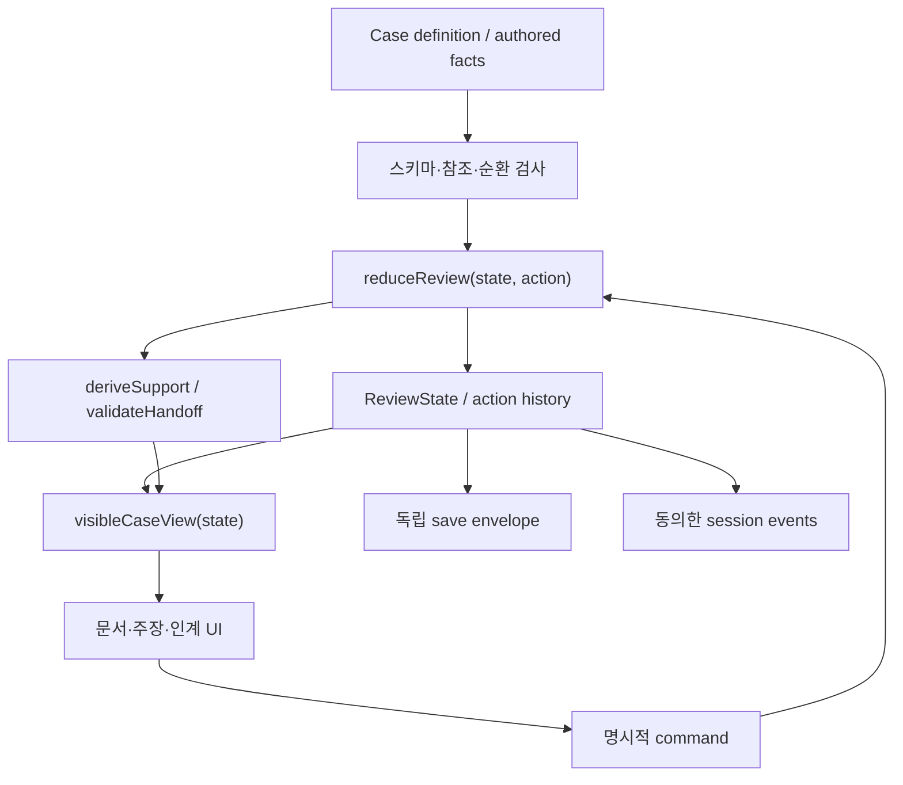

# 05 — Technical reuse and bounded rebuild plan

**PROPOSED; 이번 PR은 아래 구현을 실행하지 않는다.** 새 frontend framework·database·GPU·추론 구독은 필요하지 않다. vanilla JavaScript와 작고 순수한 reducer로 핵심 가설을 테스트한다. 재사용률을 목표로 삼지 않는다.

## KEEP / HARDEN / REFACTOR / REPLACE / REMOVE / DEFER

REMOVE는 **새 slice에 포함하지 않는다**는 뜻이다. 현재 production의 파일을 삭제하는 지시가 아니다.

| 대상 | 판단 | 이유 / 구체적 경계 |
|---|---|---|
| history, legacy, SOURCE_PROVENANCE | KEEP | 기준선/권리/회귀 기준 보존, 수정금지 |
| vanilla JS, data-engine-UI 원칙 | KEEP |1case에 충분. framework migration의 사용자 이득 없음 |
| rng.js | KEEP | seed utility는 작고 독립적. 정사는 seed로 바꾸지 않음 |
| build-single-html/integrity 원칙 | KEEP WITH HARDENING | 기존 release untouched. 새 entry는 승인 후 별도 local target, root mirror를 덮어쓰지 않음 |
| legal sources/baseline registry | KEEP WITH HARDENING | 출처/검토일/실제 규칙 범위 구분. 새 role의 실제 권한으로 오인 금지 |
| legal-engine + resolution.type validators | REPLACE (new slice) | 정답 판정은 이유의 지원 상태/인계 계약과 다름. 기존 rule 변경 없이 별도 review engine |
| case-engine/state transitions | REPLACE | arrival→decision→next가 아니라 draft→review→handoff. legacy token을 억지 매핑하지 않음 |
| statement-lock-engine | REPLACE | provenance guard가 없는 효과 함수. 비교 UI를 참고할 수 있으나 logic 재사용 없음 |
| clue-engine/question requires | REFACTOR | performed 토큰 대신 관찰된 Evidence/availability 규칙; acquired와 adopted 구분 |
| interview/personas | KEEP WITH HARDENING | 작성형 질문/응답 source만 모델로 재해석, guard와 view visibility 계약 필요 |
| intent/suggestion engines | DEFER | 목록형 입력으로 핵심 실험 가능. 추천이 해답을 노출하지 않게 재평가 |
| npc-client, api/npc, dialogue-guard | DEFER | runtime AI는 새 재미 검증과 무관. 보존하되 새 slice 의존성0 |
| behavior/rapport numeric system | REMOVE | 수치가 거짓 탐지기로 읽힘. authored 감정 대사만 사용 |
| queue/full/quick/daily | REMOVE | 새 slice는1case. 세션 편의는 이후 필요하면 별도 도입 |
| operation/airport-live/airport-load | DEFER | provenance puzzle에 필요 없음. C 선택 시에만 별도 기반 검토 |
| campaigns/achievements/companion | DEFER | 장기 progression을 단일case 검증 전에 유지하지 않음 |
| score-engine | REPLACE | throughput/정답률을 삭제한 결과 설명. guard failures·scope·remaining issues 분리 |
| debrief-engine | REFACTOR | 설명 패턴은 유지, ‘정답’ 대신 before/after claim과 근거 경로 |
| save-engine/storage | KEEP WITH HARDENING | 유효성/미래버전 보호 원칙 회수. 기존 bundle schema1에 새 사건을 강제로 넣지 않음 |
| state.js/bus | REFACTOR (isolate) | production global을 공유하지 않는 `ReviewState`, typed event payload by contract |
| analytics | REPLACE | attempted/succeeded 누락 방지, opt-in session log와 emitter integration 검증 |
| semantic CSS/a11y helpers | KEEP WITH HARDENING | 실제 helper가 state/DOM ID에 결합된 경우 단순 복사도 금지; focus·44px·motion 원칙 유지 |
| workstation UI/app boot | REPLACE (slice shell) |91ID를 맞추기 위한 fake DOM 금지. 별도 작은 entry와 독립 a11y 계약 |
| portraits/audio/speech | DEFER | grayscale placeholder나 이름만으로 실험. 자산 권리검수 후 optional |
| current tests | KEEP | 현 버전의 정상/비정상 baseline 유지. obsolete behavior test는 명시적 버전 분리 후에만 이동 |

## 새 도메인 경계

도메인 모듈은 DOM, localStorage, fetch, 전역 production state에 의존하지 않는다. 부수효과는 adapter가 수행한다. 숨은 정사는 case definition 안에 존재할 수 있으나 visible selector나 event payload로 먼저 나오지 않는다. 단일 HTML의 로컬 소스를 열어 해답을 볼 수 있다는 사실을 보안 취약점처럼 다루지 않는다. 목표는 정상 게임 인터페이스의 정보 경계다.

`Evidence`는 원자료의 정체성/출처/시간/획득 경로다. `Claim`은 특정 주체·범위·시간에 관한 진술이다. `Adoption`은 플레이어가 그 자료를 이 주장에 사용하기로 한 상태다. 셋을 같은 boolean으로 만들지 않는다. 원자료의 authoring-time truth는 결과 설명에만 제한적으로 사용하며 runtime support는 **관찰된 증거**와 authored relation predicate로만 계산한다.

처음에는 임의 graph editor/자동 NLP extraction이 필요 없다. 관계 수6개 안팎의 authored DAG, 고정 주장 카드, 선택식 인계만으로 검사한다. graph가 커질 경우 검증기를 먼저 확장하고 editor는 작성비용이 실제 병목일 때 고려한다.

## ADR 제안 — 모두 Proposed, 미승인

| ADR | 결정 / 대안 / 결과 / 뒤집을 조건 |
|---|---|
|001 Domain | ReviewState+pure reducer. 기존 case-engine 재사용 대신 선택. 상태 isolation이 늘지만 역할 혼동 감소. core 구현이 기존 엔진 의존 없이는 불가능하면 spike에서 재검토 |
|002 Legal boundary | 실제 처분 아닌 가상 근거 검토. 법률 엔진을 호출하지 않음. 고증 없는 법률 권위 방지. 실제 교육 제품으로 전환할 때 별도 법률 검토 |
|003 Provenance | sourceId/originId/derivedFrom/validAt를 명시. 문서 개수를 corroboration으로 세지 않음. DAG cycle은 authoring error. 출처를 모르면 independent가 아니라 unknown |
|004 Narrative | immutable authored canon + acquired IDs + player adoption. 모델 생성 사실 금지. 내용 조합은 작가가 검증. 새로운 사실 schema를 요구하는3case가 생기면 확장 |
|005 NPC | 작성형 질문 목록부터. intent optional. 자유 챗봇 대신 사실 경계·오프라인. measured input friction이 심할 때 분류만 실험 |
|006 Save | 새 키 `inad-rebirth-review-v1`, envelope schema1/contentVersion. 기존 bundle에 자동 import하지 않음. 두 제품 병존. 미래 version 읽기전용/export 제공 |
|007 UI | 기존 CSS semantic tokens+새 작은 shell. framework 도입 보류. 한 DOM에 list 중심, graph는 보조. 구현 복잡도가 아니라 측정된 유지비가 migration 이유 |
|008 Offline | 모든 핵심 action deterministic local. 외부 lookup은 authored 결과 공개 동작. 실제 외부기관 API 호출 없음. online 기능은 독립 gate |
|009 Reproducibility | action IDs·sequence·contentVersion; wall clock은 관측용, 결과 계산엔 사용 안 함. 같은 initial+actions→같은 state. seed는 presentation만 |
|010 Accessibility | drag 필수 아님, button/select+키보드 완전 동등, 색 외 text, 읽기 시간 무제한, reduced motion. screen reader 실제 검증 전 완료 주장 금지 |
|011 Observability | attempt→result를 같은 actionId로 연결. raw input/PII 없이 opt-in local log. 사람 연구 동의와 앱 상태 저장 분리. session erase 지원 |
|012 Evaluation | fact correctness·supported scope·procedural completion 분리. 하나의100점 점수 대신 설명. 플레이어가 이것을 이해하지 못하면 UX와 outcome model 재설계 |

## 저장과 이동

기존 `inad-meta-v54` v2, `inad-progress-v54` v1, `inad-campaign-v58` v1 및 기존 bundle schema1은 그 제품의 기록이다. 새 ReviewState로 변환할 수 있는 의미적 대응이 없다. 기존 점수를 새 사건의 완료로 환산하지 않는다.

새 envelope: `{format:'INAD_REBIRTH_REVIEW',schemaVersion:1,contentVersion:'R01.1',caseId,revision,state,checksum?}`. checksum은 손상 확인 보조이며 인증/보안 수단 아님. import는 전체 검증→임시 객체→실제 state 교체 순서. 실패 시 현재 진행을 보존. save quota 실패는 게임을 중단하지 않고 내보내기를 제시. schema/content mismatch는 임의 보정 없이 읽기 제한과 export. old namespace를 지우는 reset 금지.

슬라이스 구현 전에 별도 branch와 local entry를 만들고 baseline을 보존한다. production build target 추가/변경과 새 route 배포는 별도 승인 대상이다. 전략 PR을 병합해도 게임이 바뀌지 않도록 docs 외 diff를 금지한다.

## AI의 역할과 실패 경계

| 능력 | 기본 방식 | 허용할 모델 보조 / 금지·fallback |
|---|---|---|
| 자연어 이해 | 목록형 입력, 후일 deterministic classifier | optional questionId/null 분류. 잘못 매핑은 확인 질문,500ms local 목표·원격2s timeout 후 목록. 숨은 fact 전달 금지 |
| 인물 표현 | authored lines/정적 초상 | 개발 중 대사 초안만 사람 검수. runtime 의미 생성 기본 미사용 |
| 서사 변주 | authoring-time 분기+validator | 검증된 사실 목록 내 표현 실험도 나중. 대사→새 사실 자동 생성 금지 |
| 증거 해석 | deterministic support relations | 모델이 사실·출처 독립성·모순을 판정하지 않음 |
| 법/절차 판단 | 명시 guard와 검토된 자료 | runtime LLM 위임 금지. 가상 권한 범위를 벗어난 결론 생성 금지 |
| 채점/결과 | pure functions | 언어모델의 ‘그럴듯함’ 점수 금지 |
| persistence | schema validation/versioning | 모델이 migration 내용을 임의 보완하지 않음 |
| voice | DEFER, text동등 경로 | 나중 ASR optional; transcript 확인·전송 동의·failure fallback. 현 prototype 마이크 요구0 |
| animation | static/CSS optional | 생성영상·감정 추론 불필요. reduced motion 지원 |

세 아키텍처 비교:

| 방식 | 이점 | 비용/실패 | 결정 |
|---|---|---|---|
| A authored+deterministic | 재현·오프라인·명확한 정사 | 좋은 콘텐츠 작성비는 남음 | **채택** |
| B model-assisted classifier | 다양한 표현을 기존 선택에 연결 | 지연·오매핑·개인정보·provider drift, eval필요 | 입력 마찰이 관찰된 뒤에만 optional |
| C autonomous generative NPC/world | 표면적 대화 폭 | 출처/사실 오염, 저장 불일치, 무제한 반론, QA 비용 | 비권고 |

현재 provider 미벤치마크. open-weight는 운영비0이 아니며 서버/GPU/보안/대기열/모니터링이 추가된다. fine-tune/distillation은 질문 목록/분류 fallback이 부족하다는 증거 없이는 정당화되지 않는다. 모델 가격을 추정해 절약 효과를 발명하지 않는다. 호출량 산식은 07에 둔다.

## 테스트 전략과 안전한 이행

1. **기준선 보존:** 이번 evidence, 원본 hash, legacy, 현재 tests 유지. 발견한 F1/F2/CI 문제는 별도 명시 작업으로 분리하고 조용히 수정하지 않는다.
2. **도메인 spike:**01의 반례를 새 경계에 대응시켜 ‘미획득 근거는 지원 불가’, ‘평가가 state를 바꾸지 않음’, ‘유한 수치/예산 비음수’, ‘철회와 undo 일관성’을 검사.
3. **한 사건 UI:** Claim/Evidence selector와 handoff만. no old production imports except 승인된 pure utility. core tests는 기존 app 없이 실행 가능해야 한다.
4. **저장/a11y:** reload/action replay, corrupted/future save, keyboard/mobile를 실제 검증. 관찰 부족은 test pass로 덮지 않음.
5. **외부 검증 뒤:**2·3case로 data schema 재사용성을 증명한 뒤 새 아키텍처 확대 여부 결정. 결과가 나쁘면 isolated branch를 archive하고 main은 유지.

기존 테스트를 삭제해서 새 규칙을 통과시키지 않는다. 옛 legal verdict 테스트는 옛 제품의 regression으로 계속 남긴다. 새 slice에서는 ‘수행 token 수로 완료’ 같은 assertion을 복제하지 않으며, semantic 변경 이유를 ADR에 기록한다. 광범위 framework/format/lint cleanup은 이 계획에 포함하지 않는다.
