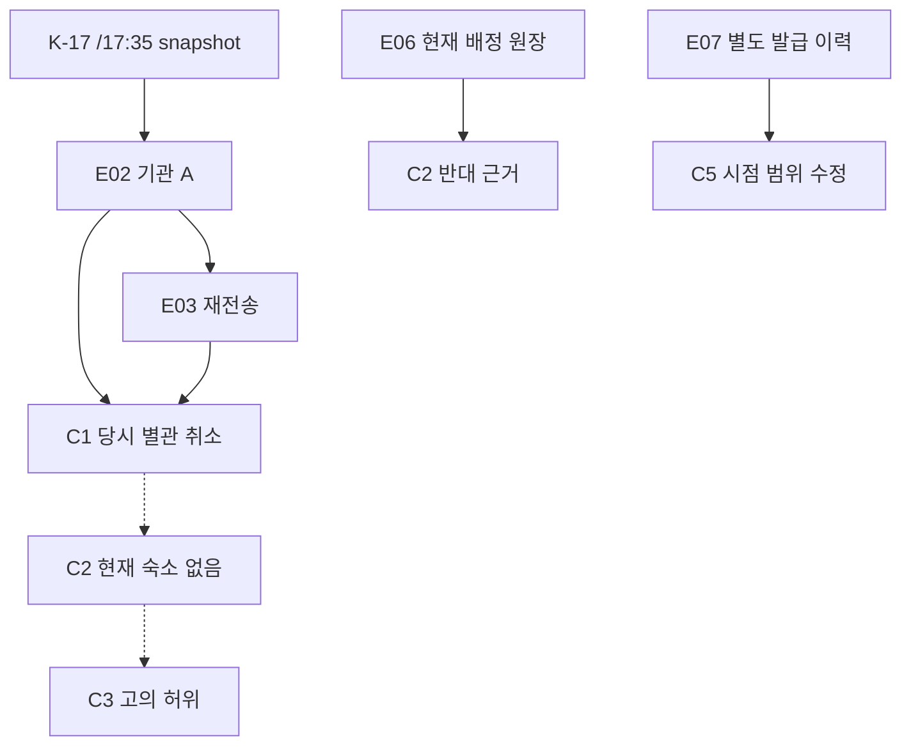
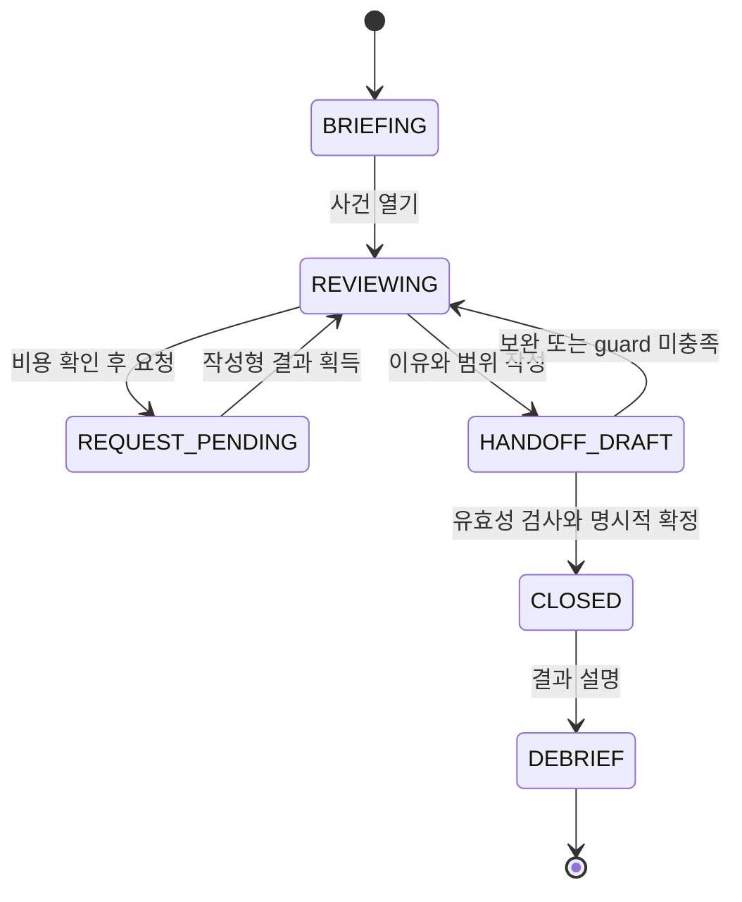

# 06 — Vertical slice: 사라진 17분

**설계 명세만 작성. 미구현·사람 미검증.** Case ID `RB-R01`, contentVersion `R01.1`. 모든 인물·기관·예약번호·시각은 허구다. 실제 입국 재심 절차를 재현하지 않는다. 가상의 기록 검토 담당자가 초안의 근거를 수정하여 원래 담당자에게 돌려주는 상황이다.

## 검증할 가설과 제한

주요 가설: 플레이어는 출처가 같은 두 기록을 독립 근거로 믿던 판단을 스스로 철회하고, 그 파급을 이해하는 것을 즐길 수 있다. 문서 클릭 횟수가 아니라 **무엇을 유지할 수 있고 무엇을 더는 주장할 수 없는지**가 달라져야 한다.

범위: 한 사건, 인물1명+작성형 기관 응답, 초기 문서3개, 최종적으로 확인 가능한 evidence8개, claim6개, 외부 확인3종, 슬롯3개, 선택형 인계3종,15분 내외 목표. AI0, 실제 외부조회0, 실시간 clock0, 음성0, 새 초상 자산0. 이 범위로 재미가 나오지 않으면 공항/캠페인을 추가하지 않는다.

## 브리핑과 초안

화면 첫 문장:

> 숙박 기록 두 건을 근거로 ‘신고 내용이 허위’라는 초안이 올라왔습니다. 당신의 임무는 입국을 결정하는 것이 아닙니다. 초안의 근거를 검토하고, 유지할 사실과 수정할 주장, 남은 확인사항을 다음 담당자에게 넘기십시오.

당사자 **서린**(가상 이름, 성별·국적·외모가 규칙 입력에 없음)은 공개 행사 참석을 위해 도착했다. 문서에는 숙소 ‘해안관 별관’, 최초 예약 `B-41`이 적혀 있다. 기관 A의 요약과 기관 B의 확인 메모 모두 ‘예약 취소’를 말한다. 초안은 두 기록을 독립 확인으로 세어 다음 주장을 채택했다.

| claim | 초안 내용 | 초안이 붙인 근거 | 정당한 범위와 문제 |
|---|---|---|---|
| C1 | B-41 별관 예약은 취소 상태였다 | E02,E03 |17:35 snapshot에 한정하면 맞음. ‘현재 숙소 없음’과 다름 |
| C2 | 현재 유효한 숙소가 없다 | C1 |시점·대체 예약을 확인하지 않은 확대 |
| C3 | 서린은 숙소에 관해 고의로 허위 진술했다 | C2, E01 |진술 시점과 변경 사유·인지 여부 없음. intent 단정 부당 |
| C4 | 두 독립 출처가 같은 사실을 확인했다 | E02,E03 |기관명은 다르나 origin이 같은지 미확인 |
| C5 |‘17:40 변경’과17:57 발급은 양립 불가능하다 | 이후 E04의 시각 주장과 제출된 발급시각 표기 |‘변경’과‘발급’이 같은 사건인지 확인하지 않은 차이. 초안에는 검토 필요 질문으로 표시 |
| C6 | 공개 행사가 실제로 존재한다 | 아직 없음 |purpose에 관한 별도 확인 항목. 숙소 해명만으로 자동 참이 되지 않음 |

초기 E01에는 정정 접수 안내의 **발급예정/처리완료 표기17:57**이 첨부돼 있지만 새 주소의 진위를 인증하지 않는다. 이 표기는 C5의 질문을 가능하게 할 뿐, 숨은 원장 사실을 제공하지 않는다. 서린의17:40 발언은 Q1 이후에만 보인다.

## 작가용 정사 — 플레이어에 선공개 금지

1.17:30 별관에 누수가 생겼다. 모든 예약자의 안전을 위해 본관으로 이전 처리했다.
2.17:35 중개 시스템 snapshot `K-17`은 별관 예약 B-41을 `cancelled`로 저장했다. 원인/대체 예약 필드는 그 snapshot에 포함되지 않았다.
3.17:40 본관의 운영 원장은 서린의 대체 예약 `R-41`을 배정했고 desk가 전화로 새 위치를 알렸다. 같은 예약자와 기존 reference를 연결한다.
4.17:57 문서 발급 서비스가 변경 확인서를 발급했다.17분은 배정과 문서 발급 사이의 지연이지 두 사건 중 하나가 거짓이라는 증거가 아니다.
5.기관 A의 E02는 K-17을 옮겼고 기관 B의 E03은 A의 응답을 재전송했다. 독립 확인이 아니다.
6.서린은 여행 전 받은 E01을 제출했고 새 문서의 주소가 검증되지 않았음을 솔직하게 말한다. 숙소 관련 고의적 허위는 없다.
7.공개 행사는 실제 존재하지만 초대장만으로 보수·실제 역할·전체 입국 적격성을 확정할 수 없다. 이 slice는 그 문제의 해답을 제공하지 않는다.

기억/시점 차이와 실제 기만의 구분이 핵심이다. 작가용 정사7은 ‘실제로 불법 취업’ 같은 숨은 정답이 아니다. 후속 게임에서도 공개되지 않은 정보를 이용해 이번 선택을 사후 처벌하지 않는다.

## 자료와 획득 계약

| ID / 자료 | 출처·시점·범위 | 초기 가시성 / 획득 | 신뢰·독립성의 한계 |
|---|---|---|---|
| E01 최초 voucher+정정 접수 표기 | 숙소 발급본, 여행 전 주소; 접수 출력17:57 | 시작부터 acquire, 열면 observed | 과거의 진짜 예약. 현 숙박상태 인증 아님 |
| E02 기관 A 조회 응답 | K-17,17:35 별관 취소 | 초기 acquire | snapshot 누락/시차. 기관 권위가 최신성 보장 아님 |
| E03 기관 B 확인 메모 | E02 재전송17:36 | 초기 acquire | 독립 원천 아님. 처음엔 요약만 보이고 계보는 E05에서 읽음 |
| E04 서린의 진술 | 당사자,17:40 전화 통지 기억 | 무료 Q1 후 acquire/observed | 주관적 진술, 원장 확인 전에는 정사로 승격 안 됨 |
| E05 전송·출처 metadata | E02/E03에 첨부된 trace, origin K-17 |‘출처정보’ 열면 공개, 비용0 | 두 계보가 같음은 확인. K-17 내용이 거짓이라는 뜻 아님 |
| E06 본관 배정 원장 | 원본 운영 ledger, current active R-41,17:40, B-41와 subject 일치 | A_LEDGER, 비용2 | 새 위치/현재 배정은 독립 확인. 문서 발급17:57나 목적은 증명 안 함 |
| E07 발급 이력 | 문서 서비스 원본,배정 이벤트17:40 참조→issued17:57 | A_ISSUE_TRACE, 비용1 | 서로 다른 사건시각임을 확인. 지금 방이 유지되는지는 원장과 별개 |
| E08 행사 주최 측 공개 기록 | 행사 날짜·장소·서린의 invitation ref만 확인 | A_EVENT, 비용1 | 행사 존재/초대 참조. 실제 역할·보수·법적 적격성은 미확정 |

원자료의 단일 ‘신뢰 점수’는 두지 않는다. `authentic`, `currentForScope`, `independentOf`, `subjectMatched`를 해당 claim의 범위에서 평가한다. E05를 읽기 전에 숨은 `originId`가 판단 UI에 새지 않는다. E06 action을 완료하기 전에 ‘현재 숙소 있음’을 노출하지 않는다. E07만으로 현재 숙소를 검증할 수 없다.

### 진술과 질문

Q1: ‘예약 변경을 언제 어떻게 알았습니까?’ → ‘17:40쯤 desk 전화로 본관으로 옮겼다고 들었습니다. 제가 제출한 것은 그 전에 받은 서류입니다.’ E04 공개.

Q2: ‘17:57은 무엇을 뜻합니까?’ → ‘문서가 나온 시각으로 알고 있습니다. 배정 원장을 본 것은 아닙니다.’ 새 독립 evidence 없음. E04의 해석 범위를 명시.

Q3: ‘행사에서 어떤 일을 합니까?’ → ‘공개 행사 초대장을 받았습니다. 실제 일정과 역할은 이 자료만으로 모두 설명하기 어렵습니다.’ 별도 불확실성. 기만 label 없음.

질문·응답 재독·통역·설명 기회는 무료이고 슬롯을 차감하지 않는다. 필요한 언어 지원은 자동 제공하거나 접근성 설정으로 선택한다. 이해하지 못한 말을 했다는 이유로 점수/시간/증거 상태를 악화시키지 않는다.

## 가설과 실제 선택

- **H1 고의적 허위 신고:** 제출 당시 취소를 알면서 유효 숙소인 것처럼 주장했을 가능성. 현재 자료만으로 intent는 지지되지 않는다.
- **H2 기록 갱신 지연:** 실제 이전 배정과 발급·조회 반영 시각이 달라 서로 다른 진짜 기록이 생겼을 가능성.
- **H3 불완전하지만 미확정:** 이전 요청은 있었으나 현재 배정은 확인하지 못했을 가능성. E07만 확보한 경우 남는 합리적 상태.

가설 선택은 메모이며 author truth를 바꾸지 않는다. 고른 가설의 색으로 정답을 알려주지 않는다.

### 확인 예산

가상 조직의 이번 검토 회차에 **외부 확인 슬롯3**이 있다. 읽기/질문/통역/수정/인계는 무료다. 권리를 사는 돈이 아니라 이번 회차에서 해결할 범위를 정하는 구성 장치다. 예산이 끝나도 당사자 설명 기회와 정당한 인계는 항상 가능하다. 기한 때문에 거부/입국을 강요하지 않는다.

| action | 조건 / 비용 | 결과 | 실제 tradeoff |
|---|---|---|---|
| A_LEDGER | E01을 열어 reference를 확인,2 | E06 | 현재 숙소를 강하게 확인하지만 남은 확인1개만 가능 |
| A_ISSUE_TRACE | E01 observed,1 | E07 |17분의 의미 확인. 현 배정이 유효한지는 못 답함 |
| A_EVENT | 초기 briefing observed,1 | E08 | 별도 목적 질문에 관해 행사 존재만 확인. 숙소 결론은 남음 |

원장2+이력1: 숙박 관련 시간차까지 설명, 행사 확인은 남음. 원장2+행사1: 현재 숙박과 행사 존재 확인, 발급 간격은 ‘설명 가능하나 외부확인 없음’으로 남음. 이력1+행사1: 슬롯1이 남지만 원장 비용2를 감당하지 못함; 불완전 인계 가능. 선택 전 비용/얻을 정보 범위를 표시해 실수로 소진하지 않게 한다. 이미 받은 조회를 반복해도 추가 비용0. 비용을 되돌리는 undo는 없으며 restart는 별도 확인 후 새 session이다.

## 근거 철회와 지원 계산

플레이어가 E02/E03을 삭제하는 것이 아니다. `Adoption(claimId,evidenceId,scope)`를 철회한다. C4의 독립 확인 주장이 지지를 잃으면 ‘두 기관 확인’에 의존한 C2/C3의 보강도 사라진다. C1은 같은 K-17 하나만으로도 **17:35 별관 취소** 범위에서 남을 수 있다.

지원 상태 네 가지:

- `unassessed`: 필요한 관찰/관계 검토가 아직 없다.
- `supported`: 관찰된 채택 근거와 명시적 관계 조건이 해당 범위를 충족한다.
- `unsupported`: 필요한 독립성/범위/근거가 부족하다. **false가 아니다.**
- `contested`: 관찰된 유효 반대 근거가 있어 범위를 좁히거나 추가 확인이 필요하다.

‘true’라는 전역 UI 상태는 없다. 현재 숙소 없음(C2)은 E06을 얻으면 반대 근거가 있어 contested. C3의 intent는 원장 이전에도 근거가 부족하다. E06이 참이어도 ‘서린의 모든 진술이 참’이라는 새로운 claim을 만들 수 없다. 근거 한 개 철회 시 다른 독립 근거가 충분하면 해당 claim은 supported를 유지한다. 이 counterexample은 필수 unit test다.



점선은 초안의 과도한 추론이며 유효 지원 관계로 승인한 선이 아니다. 의존성 graph가 연결돼 있다고 진실이 전파되면 안 된다. 관계의 범위 조건을 별도로 평가한다. 이 diagram은 작가 설명용이고 초기 플레이어 화면에 숨은 L/T 내용을 보여주지 않는다.

## 결정과 결과

| 선택 | 도메인 조건 | 결과 문구 / 성공의 범위 |
|---|---|---|
| CORRECT_AND_RETURN | 최소1개 근거 변경, 수정문은 관찰된 자료에 기반, 남은 질문 명시, 응답 기회 완료 |‘숙소 관련 초안 근거를 수정해 돌려보냈습니다.’ E06 유무에 따라 현재 숙소 확인/미확인 구분 |
| MAINTAIN_WITH_SCOPE | 유지하는 문장마다 support와 시점 표시, C2/C3 등 과도한 원문을 그대로 확정할 수 없음 | 예:‘17:35 별관 예약 취소 기록은 유지. 현재 숙박 여부·고의성 판단은 유보.’ 초안 전체 승인 아님 |
| UNRESOLVED_HANDOFF | 미확인 문제와 필요한 다음 action, 이미 확인된 사실 및 응답 기록을 지정 |‘현재 배정 여부는 다음 담당자 확인이 필요합니다.’ 안전하지만 해결한 범위가 작음을 설명 |

**형식적 성공:** 유효한 범위의 주장만 포함, 불확실성 표시, 근거 경로, 당사자 설명 기회, 명시적 confirm. **조사 성과:** 중복 계보를 발견했는가, 숙박 상태/17분/행사 중 무엇을 해결했는가. **주요 가설 성공:** 플레이어가 의미를 이해하고 판단을 수정했는가. 이 세 가지를 합쳐 하나의 ‘정답 점수’로 만들지 않는다.

실패는 무근거 고의 단정, 과거 상태를 현재로 확장, 같은 출처를 두 독립 근거로 주장, 숙박 해명을 전체 적격성으로 확대하는 시도다. `validateHandoff`는 이들 unsupported clause의 확정을 거절하고 **어떤 조건이 부족한지**만 알려준다. 숨은 정답은 말하지 않는다. 재시도 가능, 새 조회 비용 없음. 잘못된 주장 시도 횟수는 관측치이지 처벌 점수가 아니다.

모든 조사를 하지 못한 인계는 도메인 실패/게임오버가 아니다. 다만 완전한 조사 성과도 아니다. external playtest에서는 무사히 submit한 비율과 핵심 철회 이해도를 따로 집계한다. 예산을 낭비한 선택도 ‘아무 차이 없는 정답’으로 포장하지 않는다.

## 상태와 생명주기



Evidence lifecycle: `unavailable → available → acquired → observed`. 자료는 acquire 뒤 삭제하지 않는다. **채택/철회는 별도 Adoption의 상태**다. unavailable 내용을 UI tooltip/search/event/debrief 이전에 누설하지 않는다. debrief는 결과 설명을 위해 누락 자료가 있었다고 말할 수 있지만, player confidence/첫 인계 평가를 수집한 뒤 공개한다.

`REQUEST_PENDING`은 UI 중복 submit 방지용이며 실제 네트워크 의존이 아니다. 시작/완료를 같은 transaction으로 기록하거나 save 복원 시 미완료 요청을 완료/취소 중 한 가지 결정적 정책으로 정리한다. 제안 정책: command receipt가 있으면 결과 획득까지 재생, receipt가 없으면 비용 미차감. 더블탭으로 비용2회 차감 금지.

## 입력/출력 계약

```ts
// 설명용 계약. 구현 파일을 추가한 것이 아님.
type Command =
 | { id:string; type:'OPEN_EVIDENCE'; evidenceId:string }
 | { id:string; type:'ASK'; questionId:'Q1'|'Q2'|'Q3' }
 | { id:string; type:'SET_ADOPTION'; claimId:string; evidenceId:string; adopted:boolean; scopeId:string }
 | { id:string; type:'REQUEST_CHECK'; checkId:'A_LEDGER'|'A_ISSUE_TRACE'|'A_EVENT' }
 | { id:string; type:'SET_HYPOTHESIS'; hypothesisId:string|null }
 | { id:string; type:'DRAFT_HANDOFF'; draft:Handoff }
 | { id:string; type:'CONFIRM_HANDOFF'; expectedRevision:number };

type Result = { state:ReviewState; events:ReviewEvent[]; error:null|{
 code:'UNKNOWN_ID'|'NOT_OBSERVED'|'INSUFFICIENT_BUDGET'|'UNSUPPORTED_SCOPE'|'STALE_REVISION'|'CLOSED';
 visibleReason:string;
}};
// reduceReview(definition, previousState, command): Result
// deriveSupport(definition, state): Map<ClaimId, SupportResult>  // pure
// visibleCaseView(definition, state): ViewModel                // no hidden canon
// validateHandoff(definition, state, draft): Validation        // pure, no submit side effect
```

잘못되거나 알 수 없는 ID는 상태를 변경하지 않는다. 같은 commandId는 idempotent. `expectedRevision`이 다르면 오래된 UI 확정 거절. `deriveSupport`는 전역 current()/bus/behaviorAdjust를 호출하지 않는다. 평가는 획득·채택·로그를 변경하지 않는다. 임의 source text를 모델에 맡겨 evidence ID를 만드는 경로는 없다.

### 데이터 제안

```json
{
  "schemaVersion": 1,
  "contentVersion": "R01.1",
  "caseId": "RB-R01",
  "reviewScope": "fictional_record_review",
  "budget": 3,
  "evidence": [{
    "id": "E06",
    "kind": "record",
    "sourceId": "MAIN_LEDGER",
    "originId": "LEDGER_R41",
    "derivedFrom": [],
    "subjectRef": "PERSON_01",
    "validAt": "D1T18:10",
    "eventAt": "D1T17:40",
    "availability": { "afterCheck": "A_LEDGER" },
    "visibleFields": ["subjectRef", "bookingRef", "assignment", "eventAt", "validAt"],
    "facts": ["CURRENT_ALLOCATION_R41"]
  }],
  "claims": [{
    "id": "C2", "subjectRef": "PERSON_01", "scopeId": "CURRENT_LODGING",
    "text": "현재 유효한 숙소가 없다", "supportRule": "CURRENT_NEGATIVE_RECORD_REQUIRED",
    "rebuttalRules": ["CURRENT_ALLOCATION_R41"]
  }],
  "checks": [{ "id": "A_LEDGER", "cost": 2, "requiresObserved": ["E01"], "reveals": ["E06"] }]
}
```

위 JSON은 한 항목을 보이는 발췌이지 전체 실행 가능한 case file이 아니다. 전체 내용의 ID와 정사는 본 문서의 표가 계약이다. timestamp `D1`은 허구 사건 상대 날짜, 실제 UTC로 parse하는 string 아님. 구현 시 day/minute integer 등 한 형식으로 정규화한다. `facts`는 author 데이터이며 visible selector가 허용된 단계에서만 파생 표시한다.

ReviewState에는 `revision,phase,caseId,contentVersion,acquired,observed,adoptions,hypothesis,budgetRemaining,completedChecks,answeredQuestions,handOffDraft,committedHandoff,actionReceipts`만 필요하다. `sourceTruth`, `guilty`, `nationalityRisk`, `stressScore`는 없다. support cache는 저장하지 않고 복원 때 다시 계산한다. 정의 참조가 끊기거나 cycle이 있으면 case를 시작하지 않고 author error를 보고한다.

## 최소 UX

자동 정답 표시 금지: 초기 화면은 초안의 주장과 사용 근거를 보여주며 검토 결과는 `unassessed`다. 모든 주장을 한꺼번에 붉게 칠해 철회 대상을 알려주지 않는다. 플레이어가 선택한 주장에 대해 영향 미리보기를 요청하면 관찰된 자료 범위에서 지원 상태를 계산한다. 이 표시도 추론을 대신할 가능성이 있으므로 테스트에서 도움 없는 설명과 단순 색 따라 클릭을 구분한다.

Desktop: 상단 ‘이번 검토의 권한/남은 확인 슬롯’; 왼쪽 자료 목록과 provenance detail; 가운데 선택한 문서/진술; 오른쪽 주장별 ‘현재 사용 근거·지원 상태·철회 미리보기’. 하단 인계 작성. 현재 선택과 관련 없는 모든 node를 한꺼번에 그리지 않는다. 초기 C4에는 ‘계보 확인 전’ 표시를 하고 중복이라는 정답 색을 미리 주지 않는다.

Mobile390×844 및 좁은360px 목표: 자료/주장/인계3탭, 선택 자료를 drawer로 재참조. 주장 카드에서 근거ID를 누르면 source와 시점이 있는 sheet. 비교 두 항목은 세로 쌓기. 수평 graph·drag·hover 필수 금지. 탭 이동 시 scroll/focus/선택 보존. 최종 확정은 별도 review sheet+confirm, 단순 touch가 바로 처분되지 않음.

Keyboard: 각 자료/주장은 button, 출처 열기/근거 철회는 명시 action, undo 제공. dialog 진입/닫기 focus 복원. screen reader에는 ‘C2 지원 상실: 현재 시점 근거 없음’ text와 live region1회. 색만으로 supported/contested 구분 금지. 확대200%, reduced motion, 충분한 대비와44px target, 읽기시간 무제한. UI/대사 모두 한국어부터 완성하고 영어는 이 slice 범위 밖으로 명시한다.

## 결정적 fixture와 수용 검사

| fixture | 입력 순서의 핵심 | 기대 결과 |
|---|---|---|
| F01 initial | open case | E01–03 acquired, E06–08 hidden, budget3. C2/C3를 사실 확정 표시하지 않음 |
| F02 no-leak | E01 contact/field 선택처럼 무관 조작 | E06이나 원장 내용 공개0, 지원 변화0 |
| F03 duplicate | E05 open; C4의 독립성 채택 철회 | 두 근거의 independent origin수1, C1의 제한된 관측은 유지, C4 unsupported |
| F04 recovery | F03→A_LEDGER→A_ISSUE_TRACE | budget0,E06/E07 visible,C2 contested,C5 해명 가능,목적 unresolved |
| F05 alternative | F03→A_LEDGER→A_EVENT | budget0,현재 배정·행사 존재 지지,발급 시각 설명은 미확인 상태 |
| F06 limited | A_ISSUE_TRACE→A_EVENT→A_LEDGER | 마지막 INSUFFICIENT_BUDGET, budget1 유지, E06 hidden, 미해결 인계 가능 |
| F07 repeat | 같은 REQUEST_CHECK/commandId2회 | 결과/비용/analytics 중복 없음 |
| F08 withdrawal | 독립 근거2개인 별도 최소 unit graph에서1개 철회 | 다른 근거가 충분하면 supported 유지; ‘철회=거짓’ 버그 방지 |
| F09 undo | adoption 변경→역변경 | support가 원상복귀, 원자료와 budget 불변 |
| F10 scope | E06만으로 ‘전체 입국 적격’ clause 확정 | UNSUPPORTED_SCOPE, 원자료/채택 불변, 권한 밖 문장 작성 불가 |
| F11 corruption | future schema/없는 ID/cycle/negative cost import | 원래 진행 보존, start 또는 import 거절, 안내·export 가능 |
| F12 fairness | 정사/증거 같고 이름·언어·표정만 교체 | support/비용/허용 결과 동일 |
| F13 path integrity | 모든 reachable branch 조합 순회 | closed 아닌 state에서 적어도 handoff/review 가능, softlock0 |
| F14 UI | desktop/mobile/keyboard, 최종 confirm2단계 | 똑같은 도메인 결과, focus loss/가로 overflow/더블 차감0 |
| F15 persistence | 각 phase reload + action replay | 같은 derived support, closed replay mutation 거절 |

수용은 ‘테스트 개수’가 아니라 위 반례를 막는 계약을 기준으로 한다. F08의 작은 인공 graph는 이 사건에서 실제 존재하지 않는 두 독립 근거를 일반 규칙 검증용으로 만든 것으로 명시한다. F04/F05는 동일 사건의 다른 합당한 경로다.

## analytics와 디브리프

동의한 research session에서만 `{schema:1,sessionId,caseId,contentVersion,seq,elapsedActiveMs,event,actionId,entityId,resultCode}` 기록. 허용 events: `case_open`, `evidence_open`, `provenance_open`, `adoption_attempt`, `adoption_result`, `check_attempt`, `check_result`, `handoff_attempt`, `handoff_rejected`, `handoff_committed`, `debrief_open`, `next_case_selected`. attempt/result 같은 actionId로 연결. sessionId는 무작위 로컬 식별자, 계정/장치 fingerprint 아님. raw text·실명·음성·IP 수집 없음. export는 사용자가 선택, erase 제공. 게임 save와 연구 동의를 별도 처리.

유의미한 첫 행동은 ‘관련 출처 보기’ 또는 ‘근거를 채택/철회한 이유 선택’이며 단순 화면 열기는 제외. 클릭 수와 정보 획득 수를 나눠 무의미 반복을 측정한다. confidence와 이유는 결과 공개 전에 설문/관찰로 수집하고 outcome 점수와 섞지 않는다.

디브리프 순서: (1) 당신이 유지/철회한 주장 (2) 실제 확인한 근거 경로 (3) 아직 모르는 것 (4) 초안이 과도하게 확대했던 부분 (5) 다른 확인을 골랐다면 알 수 있었을 범위. ‘서린은 무조건 입국 가능’이나 ‘정답은 친절하게 대하기’라는 결론을 출력하지 않는다.
